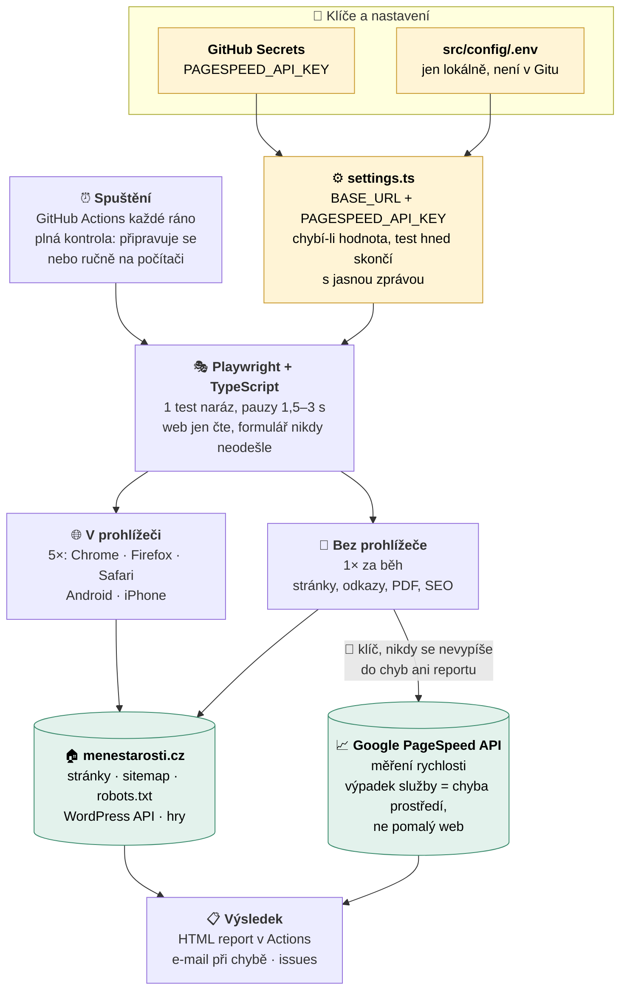

# Automatické testy webu Méně starostí

Automatická kontrola webu [menestarosti.cz](https://menestarosti.cz), neziskového webu pro seniory. Testy hlídají, že web funguje tak, jak má: stránky se načítají rychle, menu a odkazy vedou tam, kam mají, formulář jde vyplnit, web se dá pohodlně číst a ovládat i na mobilu a hry jdou spustit.

Projekt zároveň slouží jako ukázka mé práce QA testera: požadavky v podobě user stories, testovací plán, automatické testy, bug reporty a průběžné výsledky.

> **Stav:** testy pokrývají všech deset user stories a denní rychlý test běží automaticky každé ráno. Automatické spouštění plné a týdenní kontroly se připravuje.

Podrobně je vše popsané v **[testovacím plánu](docs/test-plan.md)**. Tento přehled ho jen shrnuje.

## Co se testuje

| oblast webu | v prohlížeči (5×) | bez prohlížeče | i v denním testu |
|---|:---:|:---:|---|
| [US-001](requirements/US-001.md) Dostupnost a navigace | ✔ | ✔ | část |
| [US-002](requirements/US-002.md) Kontaktní formulář | ✔ | | část |
| [US-003](requirements/US-003.md) Rychlost webu | | ✔ 🔑 | úvodní stránka |
| [US-004](requirements/US-004.md) Čitelnost pro seniory | ✔ | | úvodní stránka |
| [US-005](requirements/US-005.md) Články | ✔ | ✔ | část |
| [US-006](requirements/US-006.md) Odkazy | | ✔ | |
| [US-007](requirements/US-007.md) Materiály ke stažení | ✔ | ✔ | část |
| [US-008](requirements/US-008.md) Přístupnost | ✔ | | část |
| [US-009](requirements/US-009.md) SEO a sdílení | | ✔ | |
| [US-010](requirements/US-010.md) Hry | ✔ | | část |

Testy v prohlížeči běží v Chrome, Firefoxu a Safari na počítači, na Androidu a iPhonu. Kontroly bez prohlížeče stahují stránky přímo a běží jednou za běh. Plná kontrola obsahuje všechno z tabulky. 🔑 Rychlost měří Google PageSpeed API přes klíč `PAGESPEED_API_KEY`; ostatní testy klíč nepotřebují.

<details>
<summary><b>Zobrazit, jak to celé běží (diagram)</b></summary>



</details>

## Co automatizace dělá

| běh | kdy | co kontroluje |
|---|---|---|
| Denní rychlý test | každé ráno | hlavní stránky a menu, kontaktní formulář (vyplnění bez odeslání), načtení a spuštění her, úvodní stránka při zvětšení na 200 %, rychlost úvodní stránky na mobilu |
| Plná kontrola | úterý a pátek ráno a navíc po vydání nového článku, případně ručně | vše z denního testu, k tomu všechny články, funkčnost odkazů, přístupnost pro lidi se zdravotním omezením, čitelnost pro seniory (zvětšení stránky, velké písmo, velikost tlačítek, kontrast), základní SEO, stažení PDF souborů a jedno celé kolo her |
| Týdenní kontrola | v pátek ráno | podrobné měření rychlosti webu (PageSpeed) na mobilu i počítači a porovnání s minulým týdnem |
| Bezpečnostní kontrola | jednou týdně | pasivní kontrola webu, viz níže |
| Statistiky návštěvnosti | dvakrát týdně | návštěvnost, nejčtenější obsah, odkud návštěvníci přicházejí |

Plná kontrola v pátek ráno je záměrná: o víkendu chodí na web nejvíc lidí, takže případná chyba se najde dřív, než ji uvidí.

Testy web jen čtou: nic na něm nemění, neodesílají formuláře a nepřihlašují se do administrace.

### Omezení prostředí

Testy běží přímo proti ostrému webu, samostatné testovací prostředí neexistuje. Výsledky proto ovlivňuje i výkon hostingu: server odpovídá zhruba za 2 až 3 sekundy a při rychlé sérii dotazů přestal na chvíli odpovídat. Testy jsou proto záměrně zpomalené (vždy jen jeden test a pauzy mezi dotazy), viz [testovací plán](docs/test-plan.md). Krátkodobá nedostupnost webu se v reportu projeví jako selhání testu, i když nejde o chybu ve funkci webu. Takové selhání vyhodnocuji jako chybu prostředí, ne jako chybu webu.

### Bezpečnost a statistiky

Součástí testování jsou i pasivní bezpečnostní kontroly. Pouze čtou informace, které web veřejně ukazuje komukoli, a nikdy se nepokoušejí do webu proniknout. Jejich obsah i výsledky jsou záměrně mimo tento veřejný repozitář, protože by mohly posloužit jako návod k útoku. Stejně tak statistiky návštěvnosti. Obojí běží v samostatném soukromém repozitáři.

## Jak to funguje

1. Testy jsou napsané v nástroji [Playwright](https://playwright.dev) v jazyce TypeScript. Playwright otevře web ve skutečném prohlížeči a prochází ho jako návštěvník.
2. Testy spouští [GitHub Actions](https://docs.github.com/actions) v pevně daných dnech nebo ručně. Nezávisí na mém počítači.
3. Nový článek se pozná ráno podle seznamu změněných článků, který web zveřejňuje. Když přibyl, spustí se plná kontrola.
4. Když test selže, přijde e-mail od GitHubu. Výsledky každého běhu jsou v záložce Actions a v přehledném reportu.
5. Nalezené chyby zapisuji jako [issues](../../issues) se závažností, prioritou, náročností a tím, kdo je opraví. Otevřené chyby seřazené podle priority ukazuje [seznam chyb k opravě](docs/bugs.md), který se vytváří automaticky z issues.

### Od požadavku k testu

Co má web umět, popisují user stories ve složce [`requirements/`](requirements/). Každá má očekávané chování rozepsané do akceptačních kritérií (AK), včetně chybových a hraničních situací. Testy se na ně odkazují označením, například `US-003` a `AK2`, takže u každého testu je jasné, který požadavek ověřuje. Přehled, které testy pokrývají kterou user story, se vytváří automaticky z kódu testů, aby se nikdy nerozešel se skutečností.

### Role umělé inteligence

Při psaní testů pomáhá [Claude Code](https://claude.com/claude-code). Nejdřív spolu probereme každou oblast webu: co v ní kontrolujeme a proč. Claude pak napíše testy a já je schválím. O tom, co je správný výsledek, rozhoduji sám. Samotné automatické běhy probíhají bez AI, takže výsledek testu je pokaždé stejný a dá se zopakovat. Claude nesmí bez mého souhlasu oslabit nebo smazat žádnou kontrolu.

### Jak testy hledají prvky na stránce

Pořadí: atribut `data-testid` → role (tlačítko, odkaz, nadpis) → popisek pole → viditelný text. Jiné způsoby jen výjimečně a se zdůvodněním.

Web je postavený na WordPressu se šablonou Kadence, která atribut `data-testid` sama nepřidává. Ruční doplnění by u tohoto projektu nepřineslo zásadní výhodu, proto testy na webu hledají prvky přes role. U většího projektu bych `data-testid` doplnil.

Role hledají prvky tak, jak je vidí a čte návštěvník i čtečka obrazovky (například „tlačítko Odeslat“, „pole E-mail“). Takový test zároveň prověří, že web je srozumitelný i pro lidi, kteří ho používají se čtečkou. Atribut `data-testid` mají hry, které upravuji sám.

Příklad, proč role: kontaktní formulář má skryté pole proti spamu se stejným popiskem „Email“. Hledání podle popisku (`getByLabel`) vyplnilo právě toto skryté pole, hledání podle role (`getByRole`) skrytá pole ignoruje.

## Struktura projektu

```
requirements/        co má web umět: user stories s akceptačními kritérii
docs/                testovací plán, plán projektu, diagramy
src/pages/           jak se web ovládá: stránky a jejich prvky (Page Objecty)
src/helpers/         společné kroky přes více stránek
src/utils/           pomocné funkce bez prohlížeče
src/config/data/     očekávané texty, testovací data a adresy stránek (pages.ts)
src/config/          nastavení prostředí (.env, .env.example)
src/tests/           co se testuje, rozdělené podle oblastí webu
.github/workflows/   kdy se testy spouštějí (denní test hotový, další se připravují)
```

Každá informace je v projektu jen jednou. Když se na webu změní třeba text tlačítka, opravuje se na jediném místě. Pravidla, jak se testy píšou, jsou v [CLAUDE.md](CLAUDE.md).

## Podklady

| dokument | obsah |
|---|---|
| [docs/test-plan.md](docs/test-plan.md) | testovací plán: rozsah, rizika, přístup, kritéria, chyby |
| [requirements/](requirements/) | user stories s akceptačními kritérii |
| [docs/plan.md](docs/plan.md) | plán projektu a průběh rozhodnutí |
| [docs/plany/plan-menestarosti-tests.html](docs/plany/plan-menestarosti-tests.html) | diagram plánu, otevře se v prohlížeči |
